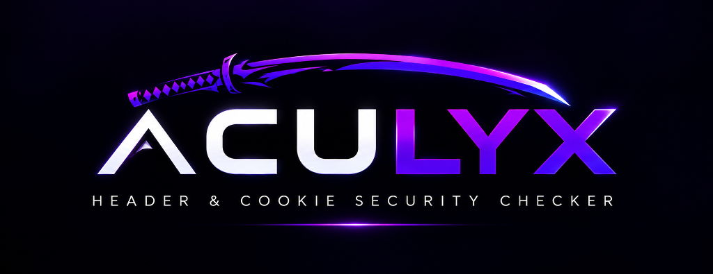

<p align="center">
  
</p>

<p align="center">
  <strong>Passive HTTP Header &amp; Cookie Security Analysis for Chromium &amp; Firefox</strong><br>
  <em>Created and authored by Dhyan Patel</em>
</p>

<p align="center">
  <a href="#features">Features</a> &bull;
  <a href="#privacy--zero-telemetry">Privacy</a> &bull;
  <a href="#cli-usage">CLI</a> &bull;
  <a href="#development--testing">Development</a> &bull;
  <a href="#license--trademark">License</a> &bull;
  <a href="docs/PROVENANCE.md">Provenance</a>
</p>

---

## Overview

**ACULYX** is a local-first, privacy-preserving browser extension built on Manifest V3 for Chromium and Firefox. It passively inspects HTTP security headers, cookie attributes, and subresource API communications as you browse, computing a real-time security grade and actionable remediation guidance without sending any data off your machine.

Because ACULYX evaluates traffic within the browser's own authenticated network context, it audits internal endpoints, dashboards, and logged-in states without requiring credential storage, active crawling, or synthetic penetration probes.

---

## Features

- **Lead Radar Multi-Sensor Surface Intelligence (v2)**:
  - **S1 (Passive Headers)**: HTTP response header extraction and policy evaluation.
  - **S2 (DOM Collector)**: Client-side DOM extraction of forms, scripts, meta tags, framework hydration state, and storage keys without values.
  - **S3 (Deep Mode Sinks & Taint Analysis)**: MAIN-world hooking of DOM sinks (`innerHTML`, `document.write`, `eval`, `location.assign`), wildcard postMessage calls, and listener origin checks.
  - **S4 (DevTools Network Body Sensor)**: In-memory live network response inspection via Chrome DevTools (`src/devtools/panel.html`) for stack traces, credentials, and exposed endpoints.
  - **S5 (Worker & Cache Surface)**: Service worker registration and cache surface auditing.
- **Lead Radar Detector Families (F1–F8)**: High-precision, false-positive resilient detector suite covering Secrets (F1), Endpoints (F2), Source Maps (F3), Auth/OAuth (F4), Params (F5), Headers (F6), Response Bodies (F7), and Cloud Reconnaissance (F8).
- **The Sieve Privacy & Masking Layer**: Ensures zero raw secrets, credentials, or sensitive query tokens leak into memory, storage, or exports, backed by 64-bit cryptographic entropy hashing and recursive field-aware sanitization across TabState, Lead Radar, and SARIF serializers.
- **Fail-Closed Scope & Resource Isolation**: Multi-sensor pipelines and background handlers independently resolve scope for external scripts, iframes, forms, and network subresources. Out-of-scope targets are strictly excluded from persistent recon memory (`ReconStore`), while S1 parameter harvesting is strictly policy-gated and in-scope gated behind active URL capture policies and incognito boundaries.
- **Content Script Sender Verification & Zero-Leakage Denials**: Strict browser-level sender verification (`sender.tab.id`, `sender.tab.url`) binds content script state queries to the calling tab, returning empty denial responses on rejected routes to prevent cross-origin state leakage.
- **MV3 Storage Session Persistence**: Seamless session recovery across background service worker idle/sleep cycles via `chrome.storage.session`.
- **Hunter Active Verification Engine**: Controlled, user-confirmed active HTTP probes for out-of-band vulnerability verification. Available via the dedicated Hunter Edition (`npm run build:hunter`).
- **Real-Time Passive Inspection**: Evaluates response headers and cookie configurations continuously during active navigation.
- **Two-Stage Redirect Tracking**: Observes headers at `onHeadersReceived` and `onResponseStarted` across every redirect hop to catch intermediate header stripping and internal HSTS upgrades.
- **Privacy-Safe Cookie Jar Correlation**: Cross-references `Set-Cookie` response headers with the live browser cookie jar to identify prefix compliance (`__Host-`, `__Secure-`), missing `HttpOnly`/`Secure` flags, `SameSite` misconfigurations, and CHIPS partitioning. **Cookie values are never accessed, persisted, or exported.**
- **Deep CSP Evaluation**: Leverages Google's `csp_evaluator` to detect script execution bypasses, JSONP endpoints, missing nonces/hashes, wildcard origins, and dangerous fallback directives.
- **Subdomain Trust & Escalation**: Identifies dangerous subdomain trust bridges where wildcard cookies (`domain=.example.com`) or permissive CORS configurations expose parent-domain sessions to subdomain compromise.
- **Attack Surface Graph**: Interactive, bounded D3-force graph mapping same-apex origin relationships, discovered endpoints, and cookie scoping trees.
- **Auth Posture & History Diffing**: Tracks origin security posture across sessions, highlighting newly introduced header regressions or resolved security weaknesses upon authentication state changes.
- **Bug-Bounty Scope Engine**: Declarative host, pattern, and port matching (`*.example.com`, `host:port`) with exclusion precedence, immediately classifying tabs as `in-scope`, `out-of-scope`, or `unknown`.
- **Researcher Triage & Notes**: Decoupled triage annotations (`unreviewed`, `needs-manual-verification`, `verified-by-researcher`, `not-reproducible`, `not-a-finding`) with automatic secret/cookie redaction and length caps before storage.
- **Bug-Bounty Report Generator**: One-click Markdown and JSON report drafting with deterministic reproduction steps, preconditions, impact narratives, and comprehensive secret/canary sanitization.
- **Scoped PoC Verification Sandbox**: Client-side verification sandbox strictly gated to targets confirmed `in-scope` under an active profile.
- **Developer CLI & CI/CD Pipeline**: Standalone CLI (`npm run aculyx`) supporting live URL audits with SSRF safeguards, offline JSON/HAR inspection, regression diffs, and GitHub Actions-ready SARIF 2.1.0 output with configurable exit codes (`--fail-on high`).

---

## Privacy & Zero-Telemetry Guarantee

ACULYX is built on strict fail-closed privacy invariants:

1. **No Sensitive Value Storage**: Extension code never reads `cookie.value`, authorization credentials, bearer tokens, or URL query parameters. All query parameters (`?`) and fragments (`#`) are stripped before URLs enter session state, storage, or exports.
2. **Strict Network Isolation**: Extension pages declare `connect-src 'none'` in their Content Security Policy. The extension runtime cannot make outbound HTTP/WebSocket requests.
3. **100% Local Processing**: All evaluation, scoring, D3 graphing, and report generation execute locally on your device.
4. **Isolated Incognito Handling**: Incognito and private browsing events never touch persistent storage (`localStorage`), history records, or the attack-surface graph.
5. **No Telemetry**: Zero analytics, zero crash reporting, zero tracking pixels, zero remote script loading.
6. **Policy-Gated Parameter Harvesting**: Query parameter harvesting (S1) is strictly gated behind the active URL capture policy and defined bug-bounty scope. If monitoring is paused/off, an origin is not granted, or a host is out-of-scope or unknown, parameter harvesting is completely halted.

> [!NOTE]
> The only command that contacts an external network endpoint is the standalone CLI when invoked with the explicit `--url` flag to fetch HTTP headers for terminal audit.

### Permissions Usage & Store Justifications
- **`cookies`**: Passively audits cookie security attributes (`HttpOnly`, `Secure`, `SameSite`, `__Host-`, `__Secure-` prefixes). Cookie values are strictly never accessed, logged, stored, or transmitted (`cookie.value` is ignored).
- **`webRequest`**: Passively reads HTTP response headers to evaluate transport security (HSTS, CSP, X-Frame-Options, CORS, Cache-Control). Does not read request/response bodies or modify network traffic.
- **`webNavigation`**: Detects document navigation completions, redirects, and client-side SPA transitions to recompute security grades for the active tab.
- **`tabs`**: Queries current tab URL and ID to display per-tab grades, update toolbar action badges, and cleanly free resources when tabs close.
- **`scripting`**: Injects client-side DOM inspection sensors (S2 DOM collector and S3 Main-World hook scripts) into user-monitored tabs to analyze DOM sinks and subresource integrity.
- **`storage`**: Used exclusively to persist user preferences, scope profiles, researcher triage notes, and bounded score history entirely on the local device.
- **`alarms`**: Triggers periodic local cache pruning and data retention cleanup without running background threads.
- **`optional_permissions` (`<all_urls>`)**: Never requested upfront. Only requested upon explicit user consent per-site or when all-sites monitoring is deliberately activated.

### Reviewer Notes (Web Store & Mozilla AMO)
- **Use of `eval` in `main-world-hooks.ts`**: The extension wraps `window.eval` in the page's MAIN execution world strictly as a passive taint-tracking sensor (Sensor 3). It observes calls made by the web page to detect unvalidated string execution. ACULYX **never** generates, compiles, or executes dynamic code via `eval()`. The original function is invoked with unmodified arguments, and only a sanitized event type is relayed to the extension.

---

## Architecture & Rules Evaluated

ACULYX audits network traffic against a versioned, defensive rule engine (`src/rules/`):

- **Transport Layer**: Strict-Transport-Security (HSTS), preload readiness, `includeSubDomains`, minimum one-year `max-age` verification.
- **Content Security**: Content-Security-Policy (CSP), `default-src`, `script-src` nonces/hashes, `object-src 'none'`, `base-uri`, and `frame-ancestors`.
- **Framing & Sniffing Protection**: X-Frame-Options (XFO) and X-Content-Type-Options (`nosniff`).
- **Cookie Security**: Flags missing `Secure`, `HttpOnly`, `SameSite=Strict/Lax`, validates `__Host-` and `__Secure-` prefix requirements, and checks `Cache-Control: no-store` on responses issuing cookies.
- **CORS & Cross-Origin Policies**: Cross-Origin-Opener-Policy (COOP), Cross-Origin-Embedder-Policy (COEP), Cross-Origin-Resource-Policy (CORP), and `Access-Control-Allow-Origin` null/wildcard misuse on API responses.
- **Subresource Integrity (SRI)**: Scans HTML scripts and stylesheets for cryptographic hash integrity attributes (`sha384`/`sha512`).
- **Information Disclosure**: Detects product and server version leakage in `Server`, `X-Powered-By`, and generator headers.

---

## CLI Usage

ACULYX provides an offline-first CLI tool for local audits and CI/CD pipelines:

```bash
# Live URL audit
npm run aculyx -- --url https://example.com --format markdown

# Offline inspection of pre-captured JSON or HAR
npm run aculyx -- --input audit.json --format sarif --fail-on high
npm run aculyx -- --har capture.har --url https://example.com/api --format json

# Baseline regression diff
npm run aculyx -- --input current.json --diff baseline.json --format markdown

# Legacy compatibility alias
npm run seccheck -- --url https://example.com
```

### Exit Codes
- `0`: All checks passed below `--fail-on` threshold.
- `1`: One or more findings met or exceeded the failure threshold (default: `high`).
- `2`: Invalid CLI arguments or malformed input data.

---

## Development & Testing

### Prerequisites
- Node.js ≥ 22.12.0
- npm ≥ 10

### Installation & Builds
```bash
# Install dependencies
npm install

# Build Chrome MV3 extension (outputs to dist/)
npm run build

# Build Firefox MV3 extension (outputs to dist-firefox/)
npm run build:firefox

# Development mode with HMR
npm run dev
```

### Quality & Verification Gates
ACULYX enforces a strict zero-tolerance gate policy:

```bash
# 1. Typecheck (zero TypeScript errors)
npm run typecheck

# 2. Strict Lint (zero warnings, zero errors, zero eslint-disable)
npm run lint -- --max-warnings=0

# 3. Unit & Integration Tests (756 tests across 52 test suites)
npm test

# 4. Playwright End-to-End Tests (9 browser tests across 2 suites; auto-builds dist/)
npm run test:e2e

# 5. Dependency Audit (zero vulnerabilities at low level)
npm audit --audit-level=low

# 6. Build Release Targets
npm run build          # Builds Chrome production distribution (dist/)
npm run build:firefox  # Builds Firefox MV3 production distribution (dist-firefox/)

# 7. Package and Verify Release Artifacts
npm run pack           # Generates ACULYX-source.zip, ACULYX-chrome.zip, and ACULYX-firefox.zip
npm run verify:pack    # Verifies entry paths, flat packaging, and manifest invariants
```

### Release Artifacts & Store Packaging

ACULYX strictly separates source distribution archives from browser store submission packages:

1. **Source Archive (`ACULYX-source.zip`)**:
   Contains complete uncompiled source files, tests, scripts, and documentation for offline building, security reviews, and audits. Excludes `dist/`, `node_modules/`, `.git/`, `.agents/`, test fixtures, reports, and binary archives.
2. **Chrome Web Store Package (`ACULYX-chrome.zip`)**:
   Flat archive of `dist/` with `manifest.json` at root. Excludes Firefox-specific Gecko settings, development source code, test suites, and internal metadata.
3. **Firefox AMO Package (`ACULYX-firefox.zip`)**:
   Flat archive of `dist-firefox/` with `manifest.json` at root. Contains `browser_specific_settings.gecko` and excludes Chrome-exclusive permissions and APIs (e.g., `sidePanel`).

---

## Project Structure

```
src/
├── background/       # MV3 service worker — capture, write barrier, lifecycle
├── content/          # S2 DOM collector & S3 Main-World hook scripts
├── devtools/         # S4 DevTools panel for in-memory network body analysis
├── leads/            # Lead Radar — F1-F8 detectors, sieve, chains, ranking, hunter
├── options/          # Full-page settings & About/Copyright dashboard
├── popup/            # Extension action popup & live scoring interface
├── rules/            # Pure TypeScript rule engine, weights, registry
├── sandbox/          # Sandboxed iframe verification workspace
├── shared/           # Appearance tokens, storage write-barrier, messaging, scope
└── sidepanel/        # Attack Surface Graph & entity relationship explorer
tests/
├── background/       # Permissions, state pipeline, capture listener tests
├── e2e/              # Playwright browser integration tests
├── fuzz/             # Property fuzzing and payload mutators
├── integration/      # Write barrier races, reset drainage, canary leak suites
├── leads/            # Lead Radar detectors, sieve, hunter, ranking, scope tests
├── reporting/        # Report builder and triage store test suites
├── rules/            # Header family fixtures and evaluation assertions
├── scope/            # Scope engine, contracts, normalization, and stress tests
└── shared/           # Storage envelopes, coalescing, and migration tests
```

---

## Author & Ownership

ACULYX is developed, authored, and owned by **Dhyan Patel**.

- **Author**: Dhyan Patel
- **Official Repository**: [github.com/Gone27/ACULYX](https://github.com/Gone27/ACULYX)
- **Provenance Record**: See [`docs/PROVENANCE.md`](docs/PROVENANCE.md) for cryptographic asset checksums and build verification instructions.

---

## License & Trademark

- **Source Code**: Licensed under the **Apache License, Version 2.0** ([`LICENSE`](LICENSE)).
- **Brand & Trademark**: The name **ACULYX**, the katana wordmark, and associated graphical marks are proprietary brand assets and trademarks of **Dhyan Patel**. The Apache 2.0 software license does not grant trademark or brand rights to use the ACULYX name or logo in derivative works or distributions without prior express written permission. See [`NOTICE`](NOTICE).
